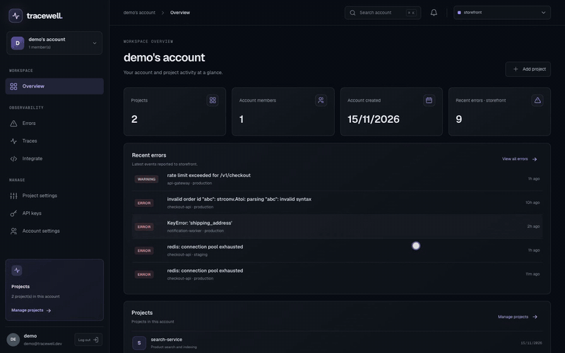

# Observability Platform API

A small Go HTTP server for receiving application error reports. Accepted
events are stored in MongoDB.

## Demo

[](docs/demo/tracewell-demo.mp4)

**[▶ Watch the full demo with voice-over](docs/demo/tracewell-demo.mp4)** (MP4, 1:20), recorded with the [Next.js dashboard](https://github.com/UmangSachdeva/Observability-Platform-frontend) on data from `examples/seed`.

## Run

```sh
go run ./cmd/server
```

The server listens on `:8080`. Set `HTTP_ADDR` to change the address. It expects
MongoDB at `mongodb://localhost:27017` by default. Start MongoDB locally before
the API, then configure the connection with:

- `MONGODB_URI` (default `mongodb://localhost:27017`)
- `MONGODB_DATABASE` (default `observability`)
- `MONGODB_COLLECTION` (default `errors`)
- `MONGODB_KEYS_COLLECTION` (default `api_keys`)
- `MONGODB_USERS_COLLECTION` (default `users`)
- `MONGODB_ACCOUNTS_COLLECTION` (default `accounts`)
- `MONGODB_INVITES_COLLECTION` (default `account_invites`)
- `MONGODB_PROJECTS_COLLECTION` (default `projects`)
- `MONGODB_SPANS_COLLECTION` (default `spans`)
- `MONGODB_OCCURRENCES_COLLECTION` (default `error_occurrences`)
- `MONGODB_TRACES_COLLECTION` (default `traces`)
- `API_KEY_ENCRYPTION_KEY` (required; base64 encoded 32-byte AES key)
- `USER_JWT_SECRET` (required; base64 encoded key of at least 32 bytes)

The server verifies the MongoDB connection at startup and exits if MongoDB is
unavailable.

## Endpoints

- `GET /healthz` returns `{"status":"ok"}`.
- `POST /v1/accounts/{accountID}/projects/{projectID}/keys` creates API credentials for a project (user JWT required).
- `GET /v1/auth/keys` lists the caller's API keys (user JWT required). `POST /v1/auth/keys` now returns `410 Gone`.
- `POST /v1/auth/signup` creates a user account.
- `POST /v1/auth/login` verifies account credentials and returns `account_id` with access and refresh JWTs.
- `POST /v1/auth/refresh` exchanges a refresh JWT for a new access and refresh JWT pair.
- `POST /v1/accounts/{accountID}/invites` creates an account invitation (admin JWT required).
- `POST /v1/invites/accept` accepts an invitation for a new or already registered user (user JWT required).
- `GET /v1/accounts/{accountID}` returns account details for a member (user JWT required).
- `GET /v1/accounts/{accountID}/projects` lists account projects (user JWT required).
- `POST /v1/accounts/{accountID}/projects` creates an account project (user JWT required).
- `DELETE /v1/accounts/{accountID}/members/me` removes the caller from the account (user JWT required).
- `GET /v1/invites` lists pending invitations for the caller's email (user JWT required).
- `PATCH /v1/invites/{inviteID}` snoozes or un-snoozes a pending invitation (user JWT required).
- `POST /v1/errors` accepts one JSON error event for the API key's project and returns `202 Accepted`.
- `GET /v1/accounts/{accountID}/projects/{projectID}/errors/{errorID}/occurrences` lists when an error happened (user JWT required).
- `GET /v1/accounts/{accountID}/projects/{projectID}/errors` searches one project's events with filters, sorting and cursor pagination (user JWT required).
- `GET /v1/accounts/{accountID}/errors` searches events across every project in the account (user JWT required).
- `POST /v1/traces` receives OpenTelemetry spans over OTLP/HTTP (project API key headers).
- `GET /v1/accounts/{accountID}/projects/{projectID}/traces` lists a project's traces (user JWT required).
- `GET /v1/accounts/{accountID}/projects/{projectID}/traces/{traceID}` returns one trace as waterfall rows (user JWT required).
- `GET /v1/accounts/{accountID}/projects/{projectID}/errors/{errorID}` returns one event of the project (user JWT required); `404 error_not_found` if it isn't in that project.

Generate an encryption key before starting the server:

```sh
export API_KEY_ENCRYPTION_KEY="$(openssl rand -base64 32)"
```

Create a user account, log in, create a project, and use the returned bearer
token to create API credentials for that project:

```sh
curl -X POST http://localhost:8080/v1/auth/signup \
  -H 'Content-Type: application/json' \
  -d '{"username":"sam_dev","email":"sam@example.com","password":"a-long-password"}'

curl -X POST http://localhost:8080/v1/auth/login \
  -H 'Content-Type: application/json' \
  -d '{"login":"sam@example.com","password":"a-long-password"}'

curl -X POST http://localhost:8080/v1/accounts/<account_id>/projects \
  -H 'Authorization: Bearer <user-jwt>' \
  -H 'Content-Type: application/json' \
  -d '{"name":"checkout"}'

curl -X POST http://localhost:8080/v1/accounts/<account_id>/projects/<project_id>/keys \
  -H 'Authorization: Bearer <user-jwt>' \
  -H 'Content-Type: application/json' \
  -d '{"client_name":"checkout-production"}'
```

Every API key belongs to one project. Any member of the project's account can
create one. The response contains `access_key`, `secret_key`, `account_id` and
`project_id`. Events sent with the key are stored under that project, so the
client never sends a project ID when reporting errors. Save the secret when
returned; it is only returned at creation time and is encrypted in MongoDB.
Keep the encryption key stable between server restarts; changing it makes
existing client secrets unusable. Key creation is rate limited to five requests
per source IP per minute.

`GET /v1/auth/keys` (user JWT) lists the caller's keys, newest first (at most
200), as `{"keys":[{"access_key":"ak_…","client_name":"…","account_id":"…","project_id":"…","created_at":"…"}]}`.
Secrets are never returned after creation.

Only client API-key signatures authorize `POST /v1/errors`; user bearer JWTs do
not. Keys created before keys were linked to projects still pass the signature
check but are refused with `403 key_not_scoped`; create a new key under a
project. Every `POST /v1/errors` call must include `X-Access-Key`, `X-Timestamp`, and
`X-Signature` headers. `X-Timestamp` is Unix time in seconds and must be within
five minutes of server time. The signature is the lowercase hex HMAC-SHA256 of
the following UTF-8 string, using the secret key as the HMAC key:

```text
<timestamp>\n<HTTP method>\n<URL path and query>\n<lowercase hex SHA-256 of exact body bytes>
```

For an empty request body, hash the empty byte string. The URL path and query
must match exactly, including the query string. Requests with a stale timestamp
or invalid signature receive `401 Unauthorized`.

User signup accepts `username`, `email`, and `password`. Usernames are
case-insensitive, 3–32 characters, and may contain letters, numbers, dots,
dashes, and underscores. Passwords must be 12–72 bytes. Passwords are stored
as bcrypt hashes, not reversibly encrypted. Signup and login return a 24-hour
`access_token` and a 30-day `refresh_token`, both JWTs. Only access tokens are
accepted by the user authentication middleware. Keep the JWT signing secret
stable between server restarts. Generate it with:

```sh
export USER_JWT_SECRET="$(openssl rand -base64 32)"
```

Signup and login are rate limited to ten combined requests per source IP per
minute.

To renew a session, send `POST /v1/auth/refresh` with
`{"refresh_token":"<refresh-jwt>"}`. The response has the same shape as the
login response: a new 24-hour `access_token`, a new 30-day `refresh_token`
(replace the old one), and `account_id`. An invalid, expired or non-refresh
token, or one for a deleted user, returns `401 invalid_refresh_token`; the
client should then log in again. Refresh is rate limited to 60 requests per
source IP per minute. Refresh tokens are stateless, so an exchanged refresh
token stays valid until it expires; there is no server-side revocation yet. The JWT is issued for account authentication; error ingestion continues
to use the signed client access/secret key scheme.

The login response includes `account_id`, so a returning user can load the same
account details and projects without relying on a previously saved signup
response. For users in multiple accounts, login selects an account they own;
if they own none, it selects their oldest membership.

Each signup also creates an account and adds the new user as its admin; the
signup response includes `account_id`. An account admin can invite an email
address to that account. The response contains a one-time `invite_token` that
must be shared with the invitee; it expires after seven days and only an
authenticated user whose email matches the invited email can accept it. This
works both for someone who already has an account and for someone who signs up
after receiving the invitation. Invite tokens are stored as hashes. Email
delivery is not connected yet, so the inviting user must deliver the token to
the invitee.

Accounts have two roles: `admin` and `member`. Only admins can invite people;
they may assign either role in the invite request. If `role` is omitted, it
defaults to `member`.

To invite someone, send `POST /v1/accounts/<account_id>/invites` with an admin
bearer JWT and `{"email":"person@example.com","role":"member"}`. Share the
returned `invite_token` with them. If they already registered, they log in
with the invited email and accept using their existing access JWT. If they are
new, they first sign up with the invited email, then use the access JWT from
signup. In either case, they call `POST /v1/invites/accept` with
`{"invite_token":"<token from the invite response>"}`. The response contains
the joined `account_id` so the client can load that account's projects and
details immediately.

Any member can leave an account with `DELETE /v1/accounts/<account_id>/members/me`
and their user JWT. The response is `{"account_id":"<account_id>","status":"left"}`.
Admins can leave too, but only while at least one other admin remains in the
account; otherwise the request returns `409` with code `last_admin`. Leaving does
not delete the user: they can still log in and accept new invitations. If a user
has left every account, the login response omits `account_id`. Rejoining the same
account needs a new invitation.

A signed-in user can see invitations sent to their email with `GET /v1/invites`.
The list contains invitations that are not accepted, not expired, and not
currently snoozed, newest first (at most 100). Add `?include_snoozed=true` to
also include snoozed ones. Each item has `id`, `account_id`, `account_name`,
`email`, `role`, `invited_by`, `created_at`, `expires_at` and, when set,
`snoozed_until`. The list does not contain the `invite_token`. To accept an
invitation from this list, call `POST /v1/invites/accept` with
`{"invite_id":"<id>"}` instead of a token; the invitation must still be for the
caller's email. Send exactly one of `invite_token` or `invite_id`.

To snooze an invitation, send `PATCH /v1/invites/<invite_id>` with
`{"snoozed_until":"2026-11-12T09:00:00Z"}`. The time must be in the future and
no later than the invitation's `expires_at`. The invitation disappears from
`GET /v1/invites` until that time. Send `{"snoozed_until":null}` to show it
again immediately. Snoozing does not change the expiry, and a snoozed
invitation can still be accepted. Invitations for another email address return
`404`, accepted ones `409`, and expired ones `410`.

Account members can list projects with `GET /v1/accounts/<account_id>/projects`
and create one with `POST /v1/accounts/<account_id>/projects`, using their user
JWT. Project data is stored in the separate `projects` collection and scoped to
its account. Each account can have only one project with a given name.

Signup request:

```json
{"username":"sam_dev","email":"sam@example.com","password":"a-long-password"}
```

Login request (use either username or email in `login`):

```json
{"login":"sam@example.com","password":"a-long-password"}
```

Example event:

```sh
EVENT_BODY='{"service":"checkout-api","environment":"production","level":"error","message":"payment request failed","stack_trace":"..."}'
```

Send those exact body bytes with the three signature headers described above.

Events persist across server restarts. MongoDB documents are stored in the
configured collection with their `account_id` and `project_id`, sorted by
receipt time when listed. Members of the account read them with
`GET /v1/accounts/<account_id>/projects/<project_id>/errors` and their user JWT.
Events stored before this change have no project and are not returned.

## Duplicate errors and occurrences

Each distinct error is stored once. Two events are the same error when they
have the same project, service, environment, level, message and stack trace.
A different message is a different error, even from the same place in the
code. Every time an error happens is kept as an occurrence (in
`error_occurrences`) with its timestamp, receive time, `trace_id`, `span_id`
and attributes, and the error's `occurrence_count` goes up.

An error's id comes from that fingerprint, so `POST /v1/errors` answers with
the same `id` for every occurrence. Error responses include
`occurrence_count`, `first_seen` and, as `timestamp`, `received_at`,
`attributes`, `trace_id` and `span_id`, the latest occurrence. Search and
sorting work on errors, so `received_at` is when the error was last seen.

A retried or replayed delivery (same timestamp, trace, span and attributes)
is not counted again: the API answers `202` with `"status": "duplicate"` and
the existing `id`. Events sent without a `timestamp` get the receive time, so
they are always counted.

`GET /v1/accounts/<account_id>/projects/<project_id>/errors/<error_id>/occurrences`
lists an error's occurrences, newest first, with `total`, `first_seen`,
`last_seen`, `limit` (1–500, default 100) and `cursor` pagination. Errors
stored before grouping existed count as one occurrence each.

Spans are deduplicated the same way: an exporter that re-sends a batch does
not store spans twice, and only newly stored spans count toward a trace's span
and error counts.

## Searching events

Both search endpoints need a user bearer JWT from a member of the account:

- `GET /v1/accounts/<account_id>/projects/<project_id>/errors` searches one project.
- `GET /v1/accounts/<account_id>/errors` searches every project in the account.
  Narrow it with `project_id`.

Query parameters (all optional):

| Parameter | Meaning |
|---|---|
| `q` | Case-insensitive text match in `message`, `service`, `environment` or `stack_trace` (max 200 characters). |
| `service`, `environment`, `level`, `project_id` | Exact match. Repeat the parameter or separate values with commas: `level=error,warning`. Up to 20 values each. `level` is case-insensitive. `project_id` is only accepted by the account-wide endpoint. |
| `attr.<key>` | Exact match on an attribute, e.g. `attr.region=eu-west-1`. Keys may contain letters, digits, `_` and `-`. Up to 10. |
| `from`, `to` | RFC 3339 range on `received_at`, inclusive. |
| `sort` | `received_at` (default, newest first as `-received_at`), `timestamp`, `level` or `service`. Prefix with `-` for descending. Ties are ordered by event `id`. |
| `limit` | Page size, 1–500 (default 100). |
| `cursor` | The `next_cursor` from the previous page. |

The response is `{"errors":[...],"has_more":true,"next_cursor":"..."}`. To get
the next page, repeat the same request with `cursor=<next_cursor>`. A cursor
only works with the filters and sort it was created for; otherwise the API
returns `400 invalid_cursor`. Pagination is keyset-based, so events arriving
while you page through do not shift or repeat results. `next_cursor` is
omitted on the last page.

Example:

```sh
curl -G http://localhost:8080/v1/accounts/<account_id>/errors \
  -H 'Authorization: Bearer <user-jwt>' \
  --data-urlencode 'q=timeout' \
  --data-urlencode 'level=error,fatal' \
  --data-urlencode 'environment=production' \
  --data-urlencode 'sort=-timestamp' \
  --data-urlencode 'limit=50'
```

Text search scans the matching project or account events, so it is slower than
the exact-match filters on large data sets.

## OpenTelemetry traces

The platform is an OTLP/HTTP trace backend. Any OpenTelemetry SDK or Collector
can send spans to `POST /v1/traces` (protobuf or JSON, optionally gzip). Spans
are stored under the project of the API key, so the sender never names a
project. Standard exporters can only send fixed headers and cannot sign each
body, so this endpoint takes the key and secret as headers; use HTTPS outside
local development:

```sh
OTEL_EXPORTER_OTLP_ENDPOINT=http://localhost:8080
OTEL_EXPORTER_OTLP_HEADERS=x-access-key=ak_...,x-secret-key=...
```

Spans with an invalid trace or span id are skipped and reported back as OTLP
`partial_success`. Spans go to the `spans` collection; a per-trace summary in
`traces` is updated as they arrive.

Reading traces needs a user JWT from a member of the account:

- `GET /v1/accounts/<account_id>/projects/<project_id>/traces` lists traces,
  newest first: `trace_id`, root span name, service and status, HTTP status,
  duration, span and error counts, services. Parameters: `q` (root span name),
  `service`, `status=error` (traces with an error span), `from`, `to`,
  `limit` (1–200, default 50) and `cursor`. `partial: true` means the
  project has not received the trace's root span; it may still be arriving or
  belong to another project.
- `GET /v1/accounts/<account_id>/projects/<project_id>/traces/<trace_id>`
  returns the waterfall: spans in display order (each parent followed by its
  children) with `offset_ms` from the trace start, `duration_ms`, `depth`,
  status, attributes, resource and events, plus the error events reported with
  that `trace_id`. A span whose parent is not in the project is marked
  `orphan`. At most 2000 spans are returned (`truncated` says when there were
  more).

Error events accept optional `trace_id` (32 lowercase hex characters) and
`span_id` (16), and error search accepts a `trace_id` filter.

**Tracing the API itself.** When `OTEL_EXPORTER_OTLP_ENDPOINT` is set, the API
creates a span for each request, named after its route (for example
`GET /v1/accounts/{accountID}/projects/{projectID}/errors`), with child spans
for signature checks, event storage and every MongoDB command, and adds
`trace_id` to its request log lines. It continues traces from incoming
`traceparent` headers. It can export to any OTLP backend, including itself:
create a project for the API, then start it with that project's key in
`OTEL_EXPORTER_OTLP_HEADERS`. Requests to `/v1/traces` and `/healthz` are not
traced, so the API does not trace the export of its own spans.

## Demo data

`examples/seed` fills a running API with realistic data for trying the
dashboard: a `storefront` project whose services (api-gateway, checkout-api,
payments-api, inventory-api, notification-worker) report recurring errors with
Go, JavaScript and Python stack traces, every occurrence linked to a
multi-service OpenTelemetry trace, plus healthy traffic and a smaller
`search-service` project. Timestamps are spread over the last three days.

```sh
go run ./examples/seed -api http://localhost:8080                     # new user demo@tracewell.dev / demo-password-2026
go run ./examples/seed -api http://localhost:8080 -login you@example.com -password '...'   # into your own account
```

## Go client, demo service and end-to-end check

`pkg/observability` is a small Go client for the API. It signs each event with a
project API key and sends it from a background goroutine, so reporting never
blocks a request:

```go
obs, err := observability.New(observability.Config{
    Endpoint:  "http://localhost:8080",
    AccessKey: os.Getenv("OBS_ACCESS_KEY"),
    SecretKey: os.Getenv("OBS_SECRET_KEY"),
    Service:   "checkout-api",
})
defer obs.Close(context.Background())        // sends queued events before exit

// Optional: send OpenTelemetry spans to the same project.
stopTracing, err := observability.StartTracing(ctx, config)
defer stopTracing(context.Background())

obs.CaptureErrorContext(r.Context(), err, map[string]string{"order_id": id}) // links to the trace
http.ListenAndServe(":9090", obs.InstrumentMux(mux)) // spans per route + panics reported as "fatal"
```

The key decides the project, so the client never sends a project ID.

`examples/demo-service` is a small shop backend built on that client. Some of
its endpoints fail on purpose:

| Request | Result | Reported event |
|---|---|---|
| `POST /checkout?amount=50` | 200 | none |
| `POST /checkout?amount=5000` | 402 | `warning` card declined, with `amount` and `order_id` |
| `GET /orders/abc` | 400 | `error` invalid order id |
| `GET /inventory` | 504 | `error` inventory timeout (`context deadline exceeded`) |
| `GET /panic` | 500 | `fatal` panic with stack trace, recovered by the middleware |

Run it with a key you created:

```sh
OBS_ENDPOINT=http://localhost:8080 OBS_ACCESS_KEY=ak_... OBS_SECRET_KEY=... \
  go run ./examples/demo-service
```

`examples/e2e` checks the whole integration against a running API. It signs
up a new user, creates a project and an API key, starts the demo service with
that key, sends the requests above, stops the demo so it flushes its queue, and
then uses the search API to confirm all six events arrived in the right project:
filters, text search, attribute filter, cursor pagination and account-wide
search. Run it from the repository root while the API is running:

```sh
go run ./examples/e2e -api http://localhost:8080
```

It prints each check and exits with status 1 if any fails. By default each run
signs up a throwaway user with its own account and project, so its events are
only visible to that user. To send them to your own account (for example to see
them in a frontend), log in as yourself:

```sh
go run ./examples/e2e -login you@example.com -password '...'                 # new demo-shop-… project in your account
go run ./examples/e2e -login you@example.com -password '...' -project <id>   # an existing project
```

`-account <id>` picks another account you belong to. Each run tags its events
with its own environment (`e2e-<suffix>`), so checks ignore older events in the
same project. Signup is rate limited to ten requests per IP per minute.

## Layers

- `controller` owns HTTP routes and request/response DTOs.
- `validation` validates incoming DTOs.
- `service` applies defaults and business rules, then uses `mapper` to convert
  transport DTOs to persisted entities.
- `repository/interfaces` defines reusable MongoDB operations such as
  `InsertOne`, `FindOne`, `Find`, `UpdateOne`, and `DeleteOne`, plus the
  entity-specific repository contracts.
- `repository/mongo` implements those interfaces with MongoDB operations and
  contains the entity-specific error-event, API-key, user, account, and invite
  repositories.
- `server` wires the layers and configures the HTTP server.
